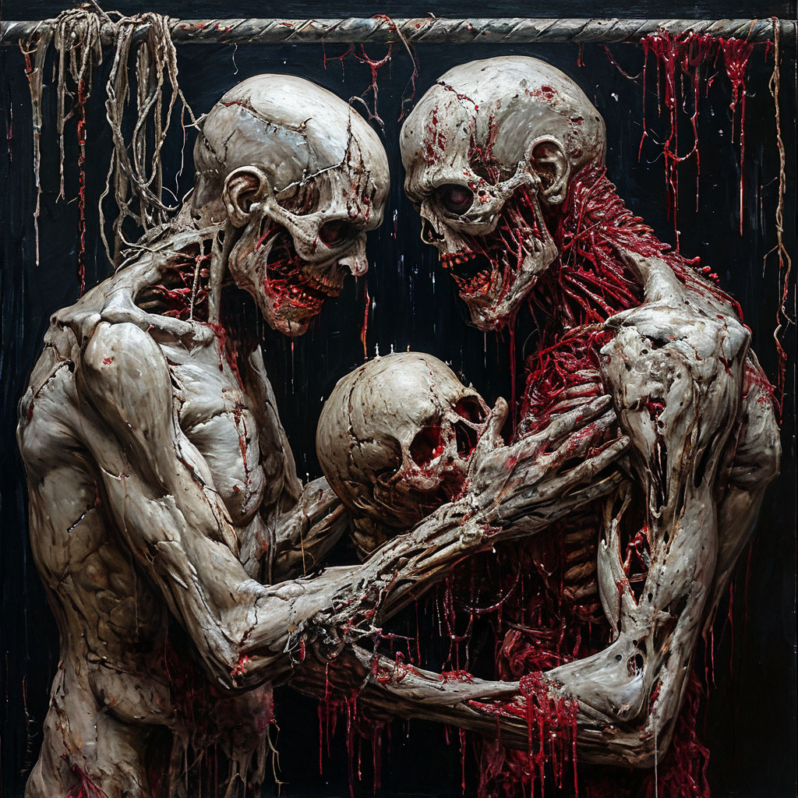

# Картина 1: Утро в сосновом лесу, И.И. Шишкин , зомби-художника

## Диалог

**Зомби:** СЮЖЕТ: Утро в сосновом лесу: три медведя-зомби жрут мозги под соснами, кишки и гниль на первом плане, рядом горохострел и подсолнух.
ДЕТАЛИ: 4

**Критик:** Фу, зомби! Но замысел не трогаю. Кишки — на розовую вату, гниль — на зефирки. Медведи жуют мозги из маршмеллоу с бантиками. Горохострел и подсолнух — с няшными глазками. Кровь уберите, брр. ОБОЖАЮ розовое, няшное, милое! 4 детали: бантики, зефир, глазки, сердечки.

**Уборщик:** О, трансцендентно! Не отменяя триумвират зомби-медведей, ввожу: 1) на соснах — экфрасис гниения; 2) горохострел и подсолнух — диалектический оксюморон; 3) кишки — аллегория институциональной критики; 4) утро — серно-жёлтый колорит. Это углубит онтологию без потери сюжета.

**Тупа пацан:** Слышь, братан, тему не рушь. Правки: 1) медведям — барсетки и цепи; 2) кальян из берцовой кости; 3) горохострел в UFC-перчатках; 4) подсолнух с тачкой Сопрано. Кишки, гниль, мозги — маст хэв. По-пацански.

**Зомби:** СЮЖЕТ: Утро в сосновом лесу: три медведя-зомби жрут мозги под соснами, кишки и гниль на первом плане, рядом горохострел и подсолнух.

ДЕТАЛИ: 5

Ворчу, но беру ОДНУ правку: кальян из берцовой кости. Бантики, зефир, глазки — фу, розовое не трогаю. Экфрасис и оксюморон — заумь, в топку. Барсетки, цепи, тачки — не мой лес. Мясо и сюжет — святое.

**Критик:** Фу, зомби! Но кальян из кости — ок. Обожаю розовое! Добавь розовый бант на мундштук, няшно! Гниль присыпь зефирками, мозги укрась сердечками, подсолнуху и горохострелу — глазки. 5 деталей: бант, зефир, сердечки, глазки, пудра. Сюжет свят, кровь убери, брр.

**Уборщик:** Апроприация кальяна одобряю. Ввожу: 1) мозги — синекдоха капитала; 2) гниль — палимпсест тлена; 3) подсолнух — парадигма солярного дискурса; 4) сосны — вертикаль власти. Мясо свято, но добавь семиотический шум. Экфрасис в топку — согласен, это моветон.

**Тупа пацан:** Принял. Правки малые: 1) кальян из берцовой кости, дым — как утренний туман. 2) Горохострел стреляет фалангами. 3) У подсолнуха — зомби-глаз. Мясо, мозги, кишки — святое. Сюжет не трогаю.

**Зомби:** СЮЖЕТ: Утро в сосновом лесу: три медведя-зомби жрут мозги под соснами, кишки и гниль на первом плане, рядом горохострел и подсолнух.
ДЕТАЛИ: 5
Ворчу. Беру ОДНУ правку: дым кальяна из берцовой кости — как утренний туман. Розовый бант, зефир, сердечки, глазки, пудра — фу, в топку. Синекдоха, палимпсест, вертикаль власти — заумь, отвергаю. Фаланги и зомби-глаз — не, мясо и сюжет святое.

## Промпт

Рассвет в сосновом бору: три гниющих медвежьих силуэта бредут среди сосен, склонившись над багровой тенью. Туман стелется дымом. Мрачная готическая хоррор-живопись, тёмная палитра с багровым, тревожные силуэты.
