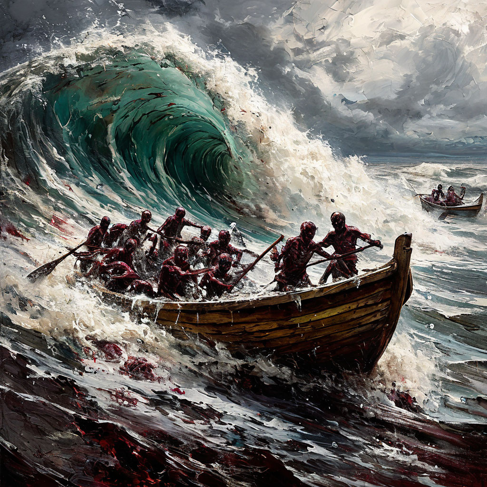

# Картина 2: Большая волна в канагаве Кацусика Хокусай, нужно МНОГО ЗОМБИ, в стиле зомби-художника

## Диалог

**Зомби:** СЮЖЕТ: Огромная волна Канагавы топит лодки, а из пены прут толпы зомби, кишки, мозги и гниль заливают всё, как в Plants vs. Zombies.
ДЕТАЛИ: 7

**Критик:** Кровь убрать: волна — розовая глазурь, пена — зефир. Зомби — плюшевые, с бантиками, румянцем. Кишки — ленты, мозги — кексы с вишенкой, гниль — блёстки. Лодки — пастельные, Хокусай в няшном свитере. Фудзи — розовая. Зомби много, но милых. Основной сюжет сохранён. Меня тошнит, но розовое спасает.

**Уборщик:** Коллегиально: волна — не вода, а деконструкция. Зомби из пены — ок. Правки: 1) пена — формалин. 2) лодки — гробы. 3) мозги — фуксия. 4) кишки — каллиграфия. 5) Луна — глаз. 6) Фудзи — коренной зуб. 7) Хокусай — зомби-куратор. Сюжет не отменяю, а семиотически углубляю.

**Тупа пацан:** Слышь, братан! Хокусай, волна, лодки — всё как у Сопрано, только зомби. Правки: 1. Пена — кишки. 2. Зомби в кимоно. 3. Самурайский меч в черепе. 4. Мозги на гребне. 5. Лодка-гроб. 6. Гниль вместо брызг. 7. Фудзи в крови. Жёстко, по-пацански!

**Зомби:** СЮЖЕТ: Огромная волна Канагавы топит лодки, а из пены лезут толпы зомби, кишки, мозги и гниль заливают всё, как в Plants vs. Zombies.
ДЕТАЛИ: 7. Беру одну правку: зомби в кимоно. Остальное — в компост.

**Критик:** Ладно, кимоно — но розовые, в цветочек, с бантами. Пена — зефирная, волна — глазурь, мозги — кексы, кишки — ленты. Зомби румяные, плюшевые, без крови и гнили. Фудзи — розовая, лодки пастельные. Сюжет цел. Брр.

**Уборщик:** ОООЧЕНЬ УМНОЕ: кимоно — семиотический саван. Правки: 1) пена — рисовый отвар. 2) лодки — гэта. 3) мозги — васаби. 4) кишки — макидзуси. 5) гниль — мисо. 6) волна — цунами-сюрр. 7) Фудзи — стёртый иероглиф. Сюжет не отменяю, а ферментирую. Зомби в кимоно — канон.

**Тупа пацан:** Братан, кимоно — чётко! Добавь зомби в барсетках и с кальянами, как в Сопрано. Волна пусть тачки топит, а из пены — UFC-шные мозги. Всё, без базара.

**Зомби:** СЮЖЕТ: Огромная волна Канагавы топит лодки, из пены лезут толпы зомби, кишки, мозги и гниль заливают всё, как в Plants vs. Zombies.
ДЕТАЛИ: 7. Ворча беру одну правку: пена — рисовый отвар. Кимоно уже есть. Розовое, васаби, гэта, барсетки — в компост. Мясо и сюжет не трогаю.

## Промпт

Гигантская волна с пенными когтями нависает над пустыми лодками, из пены поднимаются толпы зомби-силуэтов. Тёмная готическая хоррор-живопись, багровая палитра, гниющие текстуры, зловещие тени, тревожная атмосфера. Людей нет, анатомических деталей нет.
