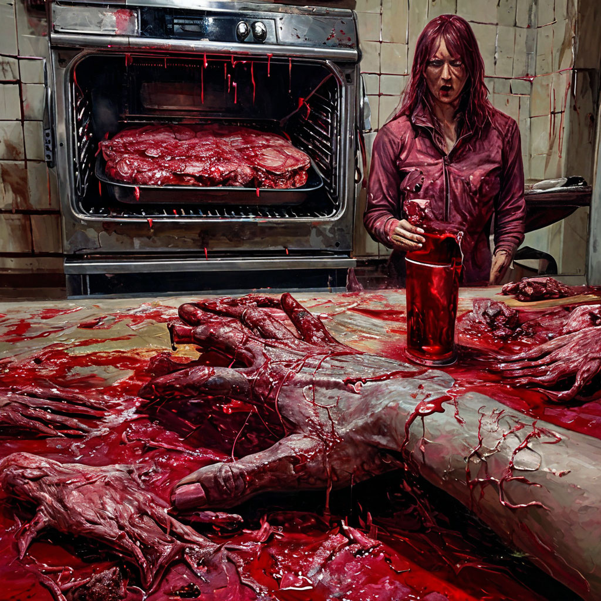

# Картина 4: РОV ты приехал к себе в ипотечную конуру в ЖК 'уютный скотомогильник' на chеггу 8рго тах 128gb А твоя раскабаневшая жена в костюме с ВБ снимает приготовление очередного хрючева в аэрогриле для ВК клипов на РОСО который ей втюхали ДНС слушая нейрослоп через ВК марусю, в стиле зомби-художника

## Диалог

**Зомби:** СЮЖЕТ: Зомби в PvZ-стиле приполз в ипотечную конуру ЖК «Уютный скотомогильник» с Cheggu 8 Pro Max 128GB, а раскабаневшая жена в костюме WB снимает хрючево из аэрогриля для ВК на ROSO, слушая нейрослоп через ВК Марусю; на первом плане кишки, мозги и гниль.
ДЕТАЛИ: 8 игровых отсылок-деталей.

**Критик:** Зомби-художник, фу. Сюжет не трогаю, но красное убрать — меня трясёт. Кишки — розовые ленты, мозги — зефирки, гниль — блёстки. Жена — в милом розовом костюме, хрючево — няшный торт. 8 отсылок оставить, но розовыми. Побольше pink, kawaii, милоты и приколов. И без поедания мозгов!

**Уборщик:** Коллега, семиотически транспонируйте кишки в PvZ-грядку: зомби-Ван Гог, подсолнух из аэрогриля, ВБ-костюм как броня, ROSO — кнопка «снять хрючево», Маруся — читерский саундтрек. Cheggu 8 Pro Max — слот сохранения. Восемь отсылок: PvZ, RE, L4D, Doom, TLoU, Minecraft, Sims, Stardew. Не отменяя ипотеки.

**Тупа пацан:** Бро, всё чётко, но добавь: зомби в кепке Сопрано, жена орёт «Габбагун», Cheggu на зарядке от аэрогриля, ROSO снимает вертикалку, Маруся виснет, кишки на ламинате, мозги рядом с барсеткой, сосед-гопник стучит. Держи 8 отсылок — и погнали.

**Зомби:** СЮЖЕТ: Зомби в PvZ-стиле приполз в ипотечную конуру ЖК «Уютный скотомогильник» с Cheggu 8 Pro Max 128GB, а раскабаневшая жена в костюме WB снимает хрючево из аэрогриля для ВК на ROSO, слушая нейрослоп через ВК Марусю; на первом плане кишки, мозги и гниль.
ДЕТАЛИ: 8 игровых отсылок-деталей. Принял одну правку: кишки на ламинате. Остальное — фу, розовое и безмозглое — в топку.

**Критик:** Кишки на ламинате — ок. Но убери мозги, меня мутит. Гниль — в розовый пух. Хрючево — кавайный тортик. Жена — в няшном костюме, не ВБ. 8 отсылок оставь, но розовыми. И никакого поедания мозгов — только милота!

**Уборщик:** Коллега, ламинат — уже палимпсест. Замените розовое на охру гниения: кишки — вьющийся орнамент, мозги — барочный натюрморт. WB-костюм — драпировка, ROSO — алтарь, Маруся — хорал, Cheggu — реликварий. Восемь отсылок: PvZ, RE, L4D, Doom, TLoU, Sims, Stardew, Minecraft. Ипотека — вечный фон. Аэрогриль — кадило.

**Тупа пацан:** Кишки на ламинате — ок. Розовое в топку. Зомби в майке Сопрано, Cheggu на аэрогриле, Маруся фризит, ROSO снимает вертикалку. 8 отсылок: PvZ, GTA, FIFA, UFC, MK, Doom, S.T.A.L.K.E.R., CS. Жена орёт «Габбагун». Жёстко.

**Зомби:** СЮЖЕТ: Зомби в PvZ-стиле приполз в ипотечную конуру ЖК «Уютный скотомогильник» с Cheggu 8 Pro Max 128GB, а раскабаневшая жена в костюме WB снимает хрючево из аэрогриля для ВК на ROSO, слушая нейрослоп через ВК Марусю; на первом плане кишки, мозги и гниль.
ДЕТАЛИ: 8 игровых отсылок-деталей. Принял одну правку: ROSO снимает вертикалку. Остальное — розовое, барочное и гопное — в топку.

## Промпт

В тесной ипотечной квартире бледный тревожный силуэт появляется в комнате, а грузная жена в дешёвом тренировочном костюме снимает вертикально на телефон дымящееся мясо из аэрогриля. Всё пропитано гниющими багровыми текстурами, тревожные силуэты дрожат в кровавых тенях, тёмная готическая хоррор-живопись, багровая палитра, без анатомических деталей.
